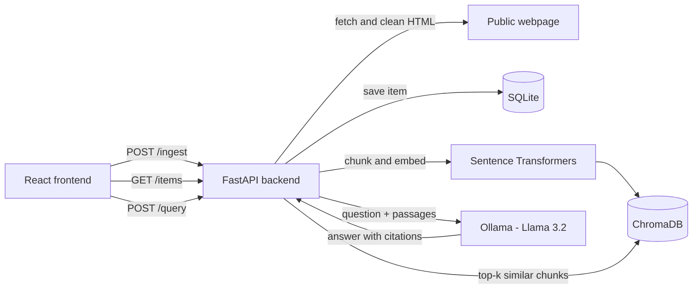

# Turium AI Knowledge Inbox

A full-stack AI knowledge inbox for saving notes and public webpages, then asking natural-language questions answered from that saved content with numbered source citations (RAG).

## Screenshots

### Save notes and webpages


### Write a note


### Ask a question: AI answer with cited sources


### Your library


## Features

- Save text notes and public webpage URLs
- Extract readable text from webpages (scripts, styles, navigation, headers and footers removed)
- Store items in SQLite with type, content and timestamp
- Split content into overlapping chunks and store embeddings in a persistent ChromaDB vector store
- Retrieve the most relevant passages for a question using semantic search
- Generate grounded answers with a local LLM (Ollama, Llama 3.2) that cite passages as [1], [2], [3]
- Show source titles, snippets and links so answers can be verified
- Fall back to returning the retrieved sources if the LLM is unavailable

## Tech Stack

| Layer | Technology |
|---|---|
| Frontend | React, TypeScript, Vite |
| Backend | Python, FastAPI, Pydantic |
| Database | SQLite, SQLAlchemy |
| Embeddings | Sentence Transformers (`all-MiniLM-L6-v2`) |
| Vector store | ChromaDB (persistent, cosine similarity) |
| LLM | Ollama, Llama 3.2 (runs locally) |

## Architecture



**Query flow:**
1. The question is embedded with the same model used for the chunks.
2. ChromaDB returns the top 3 most similar chunks (cosine similarity).
3. The chunks are numbered and sent to the LLM with instructions to answer only from them and cite `[1]`, `[2]`, `[3]`.
4. The answer and the source snippets are returned to the UI.

## Prerequisites

- Python 3.11 or compatible
- Node.js and npm
- [Ollama](https://ollama.com/) for AI answer generation
- Git

## Setup and Installation

### 1. Clone the repository

```bash
git clone https://github.com/sgayye-6612/turium-knowledge-inbox.git
cd turium-knowledge-inbox
```

### 2. Create a Python virtual environment

**Windows PowerShell:**

```powershell
python -m venv .venv
.\.venv\Scripts\Activate.ps1
```

**macOS / Linux:**

```bash
python3 -m venv .venv
source .venv/bin/activate
```

### 3. Install backend dependencies

```bash
python -m pip install -r backend/requirements.txt
```

The first run downloads the embedding model (about 90 MB) and may take a few minutes.

### 4. Configure environment variables (optional)

Copy `backend/.env.example` to `backend/.env` and `frontend/.env.example` to `frontend/.env` to change the defaults.

| Variable | Default | Purpose |
|---|---|---|
| `OLLAMA_URL` | `http://localhost:11434` | Ollama server address |
| `OLLAMA_MODEL` | `llama3.2` | Model used for answers |
| `DATABASE_URL` | `sqlite:///./knowledge_inbox.db` | Database connection |
| `VITE_API_URL` | `http://localhost:8000` | Backend URL used by the frontend |

### 5. Start the backend

```bash
cd backend
python -m uvicorn main:app --reload
```

API documentation: http://localhost:8000/docs

### 6. Start the frontend

In a second terminal, from the project root:

```bash
cd frontend
npm install
npm run dev
```

Open http://localhost:5173.

### 7. Enable AI answer generation

Install and start Ollama, then download the model:

```bash
ollama pull llama3.2
```

If Ollama is not running, the app still works and returns the most relevant source passages without a generated answer.

## API Endpoints

| Method | Endpoint | Purpose |
|---|---|---|
| GET | `/health` | Health check |
| POST | `/ingest` | Save a note or ingest a webpage |
| GET | `/items` | List saved items, newest first |
| POST | `/query` | Retrieve relevant passages and generate an answer |

### Example: save a note

```http
POST /ingest
{
  "item_type": "note",
  "title": "Python FastAPI",
  "content": "FastAPI is a Python web framework used to build APIs."
}
```

### Example: save a URL

```http
POST /ingest
{
  "item_type": "url",
  "url": "https://blogs.nvidia.com/blog/what-is-retrieval-augmented-generation/"
}
```

**Response `201 Created`:**

```json
{
  "id": 5,
  "title": "What Is Retrieval-Augmented Generation aka RAG | NVIDIA Blogs",
  "item_type": "url",
  "content": "...",
  "source_url": "https://blogs.nvidia.com/blog/what-is-retrieval-augmented-generation/",
  "created_at": "2026-10-13T08:32:00+00:00"
}
```

### Example: ask a question

```http
POST /query
{ "question": "What is RAG?" }
```

**Response `200 OK`:**

```json
{
  "question": "What is RAG?",
  "answer": "RAG retrieves relevant information from a knowledge source and gives it to a language model [1].",
  "generation": "ollama",
  "sources": [
    {
      "item_id": 3,
      "title": "RAG Basics",
      "source_url": null,
      "snippet": "Retrieval-Augmented Generation (RAG) retrieves relevant information...",
      "relevance_score": 0.71
    }
  ]
}
```

### Error responses

| Status | When |
|---|---|
| `400` | Empty note, missing URL, or a private/internal URL |
| `404` | Querying before any items are saved |
| `415` | URL does not return an HTML page |
| `422` | Invalid input, page could not be fetched, or no readable text |
| `500` | Unexpected server or retrieval error |

## Design Decisions and Tradeoffs

### Chunking
- Text is split into chunks of about **800 characters with 150 characters of overlap**, always on **word boundaries**.
- 800 characters (about 150 to 200 words) is large enough to keep a complete idea together, and small enough that a retrieved chunk stays focused on the question.
- The overlap keeps sentences that cross a chunk boundary findable from either side.
- **Tradeoff:** character-based chunking is simple and predictable, but does not follow headings or paragraphs. Sentence- or heading-aware chunking would give cleaner passages.

### Embeddings
- `all-MiniLM-L6-v2` runs locally, is fast on a CPU, and needs no paid API key, so reviewers can run the project for free.
- **Tradeoff:** larger or hosted embedding models give better retrieval quality, at the cost of speed or price.

### Vector store
- **ChromaDB** in persistent mode stores embeddings on disk and uses cosine similarity search, with no separate server to install.
- Each chunk is stored with a content hash, so only new or changed chunks are re-embedded. Chunks from deleted or changed items are removed.
- **Tradeoff:** an embedded vector store is ideal for a single-user local app, but is not designed for many concurrent writers.

### Indexing approach
- Embeddings are synced to ChromaDB when a question is asked. Unchanged chunks are skipped using the content hash, so after the first query only new items are embedded.
- **Tradeoff:** this keeps ingestion fast and simple, but the first question after adding many items is slower. In production, indexing would run in a background job at ingest time.

### LLM and grounding
- The prompt tells the model to answer only from the numbered passages, cite them, treat passage text as data rather than instructions (a basic prompt-injection guard), and say what is missing when the passages do not answer the question.
- Ollama runs locally, so no paid API key is required.
- If the LLM is unavailable, the API still returns the retrieved sources (`"generation": "retrieval_fallback"`).

### Security
- **SSRF protection:** URLs are only fetched if their host resolves to a public IP address. `localhost`, private network and internal addresses are rejected.
- Request bodies are validated with Pydantic (field types and maximum lengths).
- Webpage fetching has a 15-second timeout, and only HTML responses are accepted.

## What Would Break at Scale

- **Single-process SQLite** limits concurrent writes.
- **Indexing during queries** makes the first query after large imports slow.
- **Synchronous URL fetching** keeps the request open while a slow website responds.
- **The local LLM** is slow on a CPU and handles one request at a time well.
- **No authentication**, so all users would share one knowledge base.

## Production Changes

- PostgreSQL with **pgvector**, or a managed vector database such as Qdrant
- A **job queue** (Celery, RQ or a cloud queue) to fetch, chunk and embed at ingest time, with a `processing → ready / failed` status per item
- **Structured JSON logging** with request IDs, plus metrics and tracing
- Authentication and per-user knowledge bases
- Rate limiting and caching of embeddings and repeated questions
- A hosted LLM option for faster and higher-quality answers
- Automated tests and CI

## Limitations

- Only publicly accessible HTML pages are supported. JavaScript-rendered pages and PDFs are not.
- Some websites block automated requests.
- Redirects are not followed, so some URLs must be entered in their final form (for example `https://` instead of `http://`).
- Answer quality depends on the local Ollama model.
- This is an interview assignment, not a production deployment.

## Future Improvements

- Clickable citations that highlight the matching source card
- Delete and edit for saved items
- Search and filter in the library
- Support for PDFs and JavaScript-rendered pages